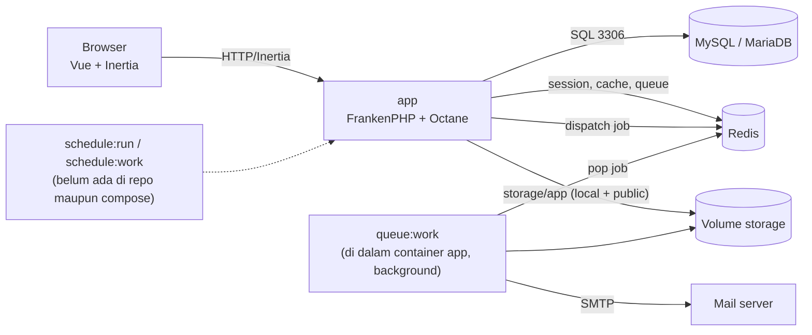
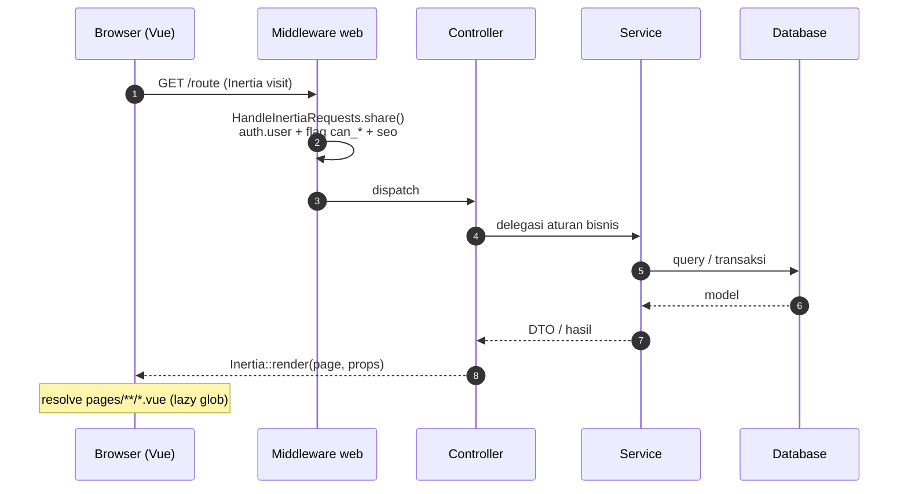
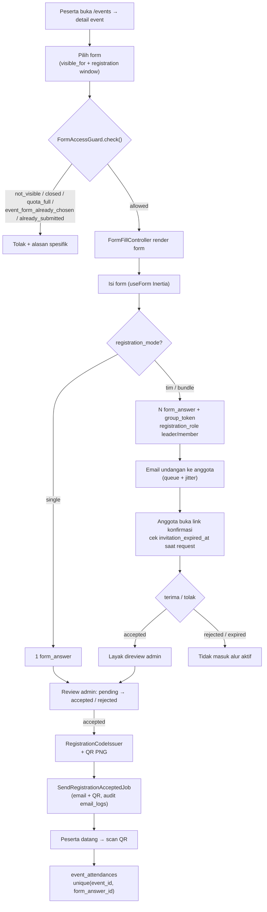
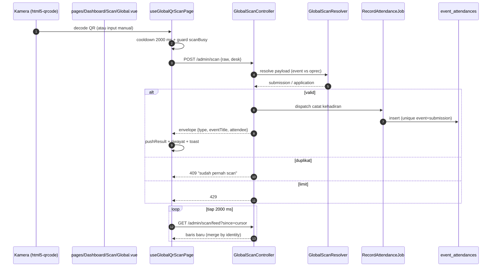
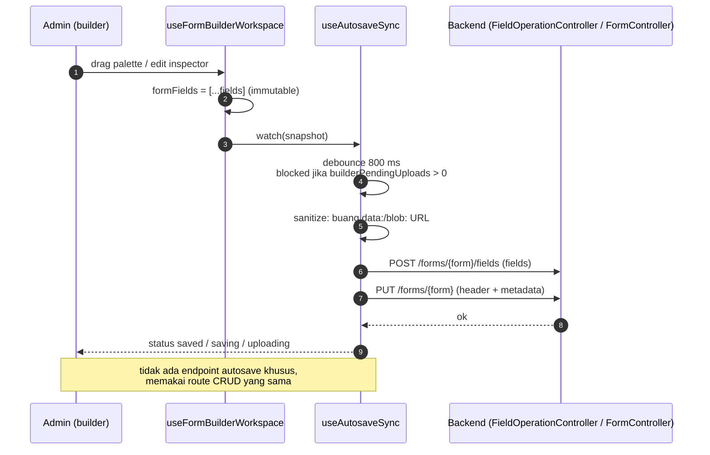
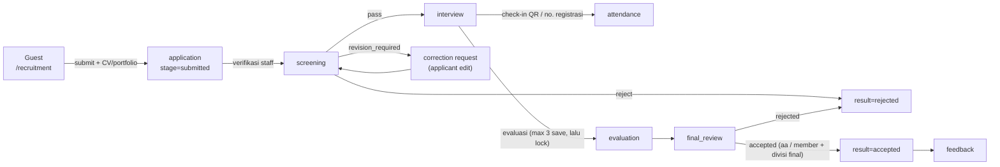
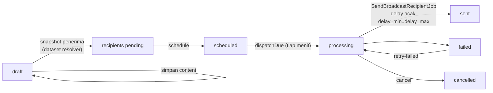
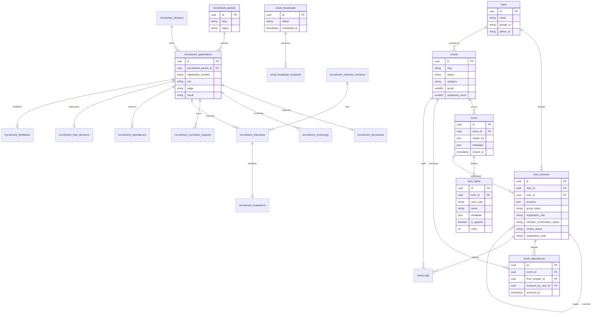
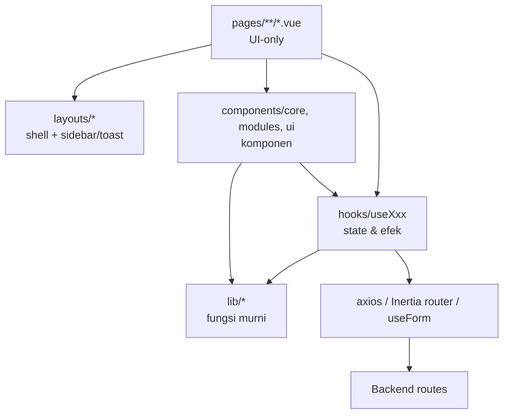

# CONTEXT.md — D-Form v2

Dokumen konteks proyek untuk sesi kerja baru (manusia maupun agent). Tujuannya: setelah membaca file ini, tidak perlu menjelaskan ulang arsitektur, domain, dan alur.

**Cara pakai**

1. Baca file ini + `AGENTS.md`. `AGENTS.md` berisi aturan kerja (mengikat); file ini berisi konteks (deskriptif).
2. Urutan otoritas saat ada konflik: **kode aktual** → `CONTEXT.md` → `docs/prd.md` / dokumen lama. PRD dan laporan lama tertinggal di beberapa titik (lihat §14).
3. Setiap klaim di bawah punya path. Kalau ragu, buka path-nya, jangan menebak.

**Cakupan:** branch `dev-zapp` (working tree saat dokumen ini ditulis). Perbedaan dengan branch `dev` dicatat eksplisit di §4.3.

---

## 1. Produk

D-Form v2 adalah aplikasi web DOSCOM untuk **mengelola event dan pendaftaran peserta secara dinamis**:

- Admin membuat **event**, lalu merancang **form pendaftaran** dengan form builder (tanpa ubah kode).
- Peserta mengisi form; submission disimpan sebagai JSON, direview admin, lalu menerima **email konfirmasi berisi QR**.
- Kehadiran dicatat lewat **scan QR** (kamera browser) dan tampil real-time di feed lintas meja.

Di dalam repo yang sama ada **modul kedua yang mandiri**: **OpRec (DOSCOM OpenRecruitment)** — pendaftaran anggota tanpa akun, screening, interview, antrean, penilaian, seleksi akhir, feedback. Modul ini memakai domain tabel sendiri (`recruitment_*`) tetapi memakai ulang auth, queue email, QR, dan storage.

**Fitur dorman:** Email Broadcasting (kirim email massal) sudah ada kodenya, tetapi dimatikan default lewat `FEATURE_BROADCAST=false` (`config/features.php`). Selama flag false: route `/admin/broadcasts/*` tidak terdaftar, policy menolak, UI disembunyikan.

**Bukan bagian produk:** aplikasi mobile native, payment gateway, integrasi kalender (lihat `docs/prd.md` §9).

---

## 2. Stack

| Lapisan             | Teknologi                                                     | Bukti                                              |
| ------------------- | ------------------------------------------------------------- | -------------------------------------------------- |
| Backend             | Laravel 12, PHP `^8.2` (image runtime PHP 8.4)                | `composer.json`, `docker/Dockerfile.prod`          |
| App server          | Laravel Octane + FrankenPHP                                   | `config/octane.php`, `docker/entrypoint*.sh`       |
| Frontend            | Vue 3.5 + Inertia 2 + TypeScript `strict`                     | `package.json`, `tsconfig.json`                    |
| Styling             | Tailwind CSS v4 (CSS-first) + shadcn-vue (new-york) + Reka UI | `resources/css/app.css`, `components.json`         |
| Build               | Vite 7 + Wayfinder codegen + ESLint plugin                    | `vite.config.js`                                   |
| DB                  | MySQL 9 (dev), MariaDB 10.11 (prod), SQLite `:memory:` (test) | compose files, `phpunit.xml`                       |
| Cache/session/queue | Redis 8                                                       | `.env.example`, compose files                      |
| Queue               | Laravel Queue (Redis) + 15 job class                          | `app/Jobs/**`                                      |
| QR                  | `endroid/qr-code` (PNG via GD)                                | `composer.json`, README                            |
| Permission          | `spatie/laravel-permission`                                   | `database/seeders/RoleSeeder.php`                  |
| Excel/CSV           | `openspout/openspout`                                         | `composer.json`, controller export                 |
| Editor              | Tiptap 3 (broadcast + rich text)                              | `package.json`                                     |
| Auth sosial         | Laravel Socialite (GitHub; kolom Google ada)                  | `routes/web/auth.php`, `users.google_id/github_id` |

Timezone aplikasi `Asia/Jakarta` (`config/app.php`, `.env.example`).

---

## 3. Topologi runtime

| Aspek            | Dev (`docker-compose.yml`)      | Prod (`docker-compose.prod.yml`)      |
| ---------------- | ------------------------------- | ------------------------------------- |
| Port app         | `3000:8000` + `5173` (Vite HMR) | `expose 8000`, tanpa port host        |
| DB               | `mysql:9.0`, port `3308`        | `mariadb:10.11`, internal-only        |
| Redis            | `redis:8.0-alpine`, AOF on      | `redis:8.0-alpine`                    |
| phpMyAdmin       | ada (`8090`)                    | tidak ada                             |
| Source           | bind-mount `.:/app`             | image multi-stage (`Dockerfile.prod`) |
| Worker/scheduler | tidak ada service               | tidak ada service                     |

**Konsekuensi operasional (penting):** compose tidak menyediakan service queue worker maupun scheduler terpisah. Queue worker **sudah** berjalan di dalam container `app` sebagai proses background dari entrypoint (`QUEUE_WORKER` default `1`, lihat `docker/entrypoint.sh:105-110` untuk dev dan `docker/entrypoint.prod.sh:201-206` untuk prod, dengan loop restart 2 detik). Yang benar-benar belum ada adalah **scheduler**: tidak ada `schedule:run`/`schedule:work` di entrypoint, compose, Jenkins, maupun systemd host, padahal `bootstrap/app.php` mendaftarkan task terjadwal.

Task terjadwal (`bootstrap/app.php` → `withSchedule`):

- `recruitment:send-interview-reminders` — tiap 15 menit.
- `broadcast:dispatch-scheduled` — tiap menit (no-op saat `FEATURE_BROADCAST=false`).
- `otp:prune` — tiap jam.

---

## 4. Peta direktori

### 4.1 Backend (`app/`)

| Path                   | Isi                                                                                 | Catatan                                                                                                                       |
| ---------------------- | ----------------------------------------------------------------------------------- | ----------------------------------------------------------------------------------------------------------------------------- |
| `app/Http/Controllers` | 68 controller                                                                       | dibagi `Auth`, `Dashboard/{Events,Scan,Users,User,Recruitment,Broadcasts,Broadcasting}`, `Events/Forms`, `Recruitment`        |
| `app/Services`         | 77 service                                                                          | domain dibagi per folder: `Event`, `Form`, `Registration`, `Recruitment`, `Scan`, `Broadcasting`, `Reporting`, `User`, `Auth` |
| `app/Jobs`             | 15 job                                                                              | email, broadcast, `RecordAttendanceJob`                                                                                       |
| `app/Models`           | 15 model root + 14 `Recruitment/*`                                                  | relasi & cast lihat §7                                                                                                        |
| `app/Enums`            | 16 enum + 10 `Recruitment/*`                                                        | kosakata domain di §5                                                                                                         |
| `app/Observers`        | hanya `EventObserver`                                                               | invalidasi cache list + cascade soft-delete forms/fields                                                                      |
| `app/Policies`         | policy per domain                                                                   | auto-discovery, tanpa registrasi manual                                                                                       |
| `app/Support`          | helper domain (`RegistrationQrPayload`, `FormFieldTypeMapping`, `PublicStorage`, …) | bukan helper generik                                                                                                          |
| `app/Mail`             | Mailable + template                                                                 | `Mail/Recruitment/*`                                                                                                          |
| `app/Notifications`    | notifikasi                                                                          | dipakai sebagian alur                                                                                                         |
| `routes/web/*.php`     | 5 file root + 6 file `admin/`                                                       | dimuat dinamis oleh `routes/web.php`                                                                                          |

Lapisan yang **tidak ada**: `app/Events`, `app/Listeners` kosong; tidak ada event broadcasting realtime. Kata "Broadcast" di repo ini berarti **email massal**, bukan WebSocket.

### 4.2 Frontend (`resources/js/`)

| Path                                | Isi                                                                                                                        |
| ----------------------------------- | -------------------------------------------------------------------------------------------------------------------------- |
| `pages/`                            | 58 file Vue: 57 page route Inertia + 1 komponen anak (`Dashboard/Recruitment/MyInterviews/InterviewRowCard.vue`)            |
| `layouts/`                          | `DashboardLayout`, `DashboardFocusLayout`, `FormFillLayout`, `AuthLayout`, `LandingLayout` (`AppLayout.vue` tidak dipakai) |
| `components/ui/`                    | 35 direktori: 27 shadcn-vue asli + 8 wrapper non-shadcn (utang teknis)                                                     |
| `components/core/`                  | wrapper tipis: auth input/button, modal konfirmasi, pagination, deferred render, lottie                                     |
| `components/modules/`               | komponen per fitur: `auth/`, `builder/`, `dashboard/`, `landing/`, `open-recruitment/`, `user/`                            |
| `components/seo/`                   | `SeoHead.vue` untuk title, description, canonical URL, dan JSON-LD pada page yang membutuhkannya                           |
| `hooks/`                            | 23 composable `useXxx` + barrel `index.ts`; dua guard global dipanggil langsung dari `app.js`, hook lain dipakai page/component |
| `utils/composables/`                | **dihapus** pada `FE-AUDIT-003`; `utils/` hanya menyisakan `stripHtml.ts` dan `theme.js` legacy                          |
| `lib/`                              | 37 file: 36 fungsi murni + `routes.ts` (jalur URL manual, 75 import)                                                       |
| `types/`                            | kontrak TS: `global.d.ts`, `form.ts`, `form-builder.ts`, `event.d.ts`, `seo.d.ts`, …                                       |
| `routes/`, `actions/`, `wayfinder/` | **generated** oleh Wayfinder — jangan diedit manual                                                                        |

### 4.3 Drift yang harus diketahui

`dev-zapp` memiliki `resources/js/hooks/` dengan 23 composable + barrel `index.ts` dan menggunakannya dari `app.js`, page, serta component. `utils/composables/` sudah dihapus pada `FE-AUDIT-003`; `utils/` hanya menyisakan `stripHtml.ts` dan `theme.js`. `autosaveGuard.ts` dan `dirtyFields.ts` belum ada di branch ini. Aturan `AGENTS.md` tetap menjadi target struktur.

---

## 5. Glosarium domain

### 5.1 Event & form

| Enum / istilah             | Nilai                                                                                                                                                                                                                                       | Arti                                           |
| -------------------------- | ------------------------------------------------------------------------------------------------------------------------------------------------------------------------------------------------------------------------------------------- | ---------------------------------------------- |
| `EventStatus`              | `draft`, `published`                                                                                                                                                                                                                        | status tampil event                            |
| `EventCategory`            | `rkt`, `non-rkt`, `recruitment`, `etc`                                                                                                                                                                                                      | kategori event                                 |
| `EventSession`             | `general`, `programming`, `network`, `media_creative`, `data`                                                                                                                                                                               | sesi/divisi event                              |
| `EventRegistrationStatus`  | `not_yet_open`, `open`, `closed`, `full`                                                                                                                                                                                                    | status pendaftaran turunan                     |
| `EventFormVisibility`      | `public`, `participant`, `admin`                                                                                                                                                                                                            | siapa boleh melihat/mengisi form               |
| `FormPurpose`              | `registration`, `other`                                                                                                                                                                                                                     | form pendaftaran vs form lain (mis. prasyarat) |
| `FormAccessStatus`         | `allowed`, `not_visible`, `form_closed`, `registration_not_open`, `quota_full`, `unsupported_registration_mode`, `pending_team_confirmation`, `invitation_closed`, `already_submitted`, `event_form_already_chosen`, `prerequisite_not_met` | hasil guard akses form                         |
| `FormAnswerReviewStatus`   | `pending`, `accepted`, `rejected`                                                                                                                                                                                                           | review admin per submission                    |
| `RegistrationRole`         | `leader`, `member`                                                                                                                                                                                                                          | peran dalam tim/bundle                         |
| `MemberConfirmationStatus` | `pending`, `accepted`, `rejected`, `expired`                                                                                                                                                                                                | konfirmasi anggota                             |
| `EmailLogStatus`           | `queued`, `sent`, `failed`                                                                                                                                                                                                                  | audit email                                    |
| `EmailNotificationType`    | `registration_*`, `team_invitation`, `attendance_confirmed`, `recruitment_*`, …                                                                                                                                                             | jenis email                                    |

**Mode pendaftaran form** (`forms.metadata.registration_mode`): `single` (individu), tim/bundle (banyak `form_answer` per submit). Field yang boleh diubah anggota saat konfirmasi ditandai `form_fields.is_append`; field yang diulang per anggota ditandai `form_fields.metadata.duplicatable`.

### 5.2 OpRec

| Enum                       | Nilai                                                                                                                           |
| -------------------------- | ------------------------------------------------------------------------------------------------------------------------------- |
| `RecruitmentPeriodStatus`  | `draft`, `open`, `closed`, `archived`                                                                                           |
| `ApplicationStage`         | `submitted`, `screening`, `interview`, `final_review`, `completed`                                                              |
| `ApplicationResult`        | `pending`, `accepted`, `rejected`, `cancelled`                                                                                  |
| `ScreeningDecision`        | `pass`, `revision_required`, `reject`                                                                                           |
| `ScreeningReason`          | `incomplete_data`, `invalid_data`, `document_mismatch`, `document_unreadable`, `info_mismatch`, `requirements_not_met`, `other` |
| `CorrectionRequestStatus`  | `pending`, `approved`, `rejected`, `completed`                                                                                  |
| `InterviewStatus`          | `waiting`, `in_progress`, `completed`, `cancelled`                                                                              |
| `AttendanceMethod`         | `qr`, `registration_number`                                                                                                     |
| `EvaluationRecommendation` | `recommended`, `not_recommended`                                                                                                |
| `MembershipType`           | `aa`, `member`                                                                                                                  |

### 5.3 Broadcast (dorman)

`EmailBroadcastStatus`: `draft`, `scheduled`, `processing`, `completed`, `cancelled`, `failed`.
`EmailBroadcastRecipientStatus`: `pending`, `processing`, `sent`, `failed`, `cancelled`.
`EmailDatasetSourceType`: `event_participants`, `recruitment_applicants`, `users`, `custom`.

---

## 6. Alur utama

### 6.1 Siklus request Inertia

- `resources/js/app.js` memakai `import.meta.glob('./pages/**/*.vue')` tanpa `eager`; page dimuat saat route Inertia memerlukannya dan tidak seluruhnya masuk entry awal.
- Error 5xx/419 ditangani global di `app.js` (toast), bukan per halaman.
- `HandleInertiaRequests` mengirim `auth.user` + 16 flag akses (15 `can_*` + `is_recruitment_interviewer_only`) + `seo`. Dipakai luas untuk menyembunyikan menu.

### 6.2 Pendaftaran event (single / tim / bundle) → email QR → kehadiran

Fakta kunci:

- Guard akses berurutan 5 lapis: visibility → `closed_at` → window/quota/form-lain → prasyarat → duplikat/undangan. Admin (`events.list`) dikecualikan dari visibility & window, tetap kena cek duplikat (`app/Services/Form/FormAccessGuard.php`).
- Kuota memakai counter denormalisasi `events.registered_count` dengan `lockForUpdate` (`app/Services/Registration/EventRegistrationCounter.php`).
- Undangan kedaluwarsa **tanpa scheduler**: dicek saat request membuka link (`config/registration.php`, `invitation_ttl_days` default 7).
- Email diberi jeda + jitter untuk menghindari rate limit SMTP (`REGISTRATION_EMAIL_SEND_DELAY_SECONDS=7`, jitter 5–10 detik, dimatikan saat testing).
- Unique `(user_id, form_id)` untuk submission aktif hanya berupa **partial unique index** di SQLite/PostgreSQL; di MySQL turun jadi index biasa sehingga proteksi bergantung pada lapisan aplikasi.

### 6.3 Scan QR & feed lintas meja

- Identitas meja disimpan di `sessionStorage['scan-desk-id']`.
- Rate limit (`app/Providers/AppServiceProvider.php`): `scan-page` 120/menit, `scan-feed` 240/menit, `scan-store` 60/menit, `scan-export` 30/menit.
- Export: `/admin/scan/export?kind=&target=&format=csv|xlsx`.

### 6.4 Form builder + autosave

- Sumber state tunggal: `useFormBuilderWorkspace` (`resources/js/hooks/useFormBuilderWorkspace.ts`).
- 17 tipe builder dipetakan ke 7 `input_type` backend (`components/modules/builder/fieldMapping.ts`); metadata menyimpan `builderType`, `rules`, `placeholder`, `content`.
- Banner disimpan sebagai **field sintetis** `form_banner` (`formBanner.ts`), bukan kolom form.
- Tipe display-only (`heading`, `paragraph`, `divider`, `banner`, `image`) tidak ikut answer key.
- Race: `saveSeq` hanya menjaga status; request tidak dibatalkan/diantrekan, jadi dua flush bisa selesai tidak berurutan.
- Draft lokal `OpenRecruitment/Apply.vue` memakai opsi `storage` (`localStorage`), tanpa jaringan.

### 6.5 OpRec (end-to-end)

- Applicant **tanpa akun**; tracking memakai token (hash di DB) + NIM unik per periode (`unique(period_id, nim)`).
- Interview bisa `primary`/`secondary`; interviewer mengklaim slot; antrean ruang tunggu dikelola `InterviewLifecycleService`.
- Evaluasi terkunci setelah `save_count` mencapai batas; `unique(interview_id)`.
- Rate limit: `oprec-apply` 5/menit, `oprec-track` 5/menit, `oprec-queue` 60/menit per IP.
- Dokumentasi modul lengkap: `docs/module/oprec/`.

### 6.6 Email broadcast (dorman)

Selama `FEATURE_BROADCAST=false`, seluruh alur ini tidak dapat diakses. `.env.example` juga tidak mengaktifkannya.

---

## 7. Skema data

Catatan skema:

- `form_answers.answers` = JSON; satu baris = satu peserta (QR & approval **per individu**), dihubungkan `group_token` untuk bundle.
- `event_attendances` unik `(event_id, form_answer_id)` — scan ganda ditolak di DB.
- `forms.event_id` **nullable** sejak migrasi `2026_09_23` (form OpRec tidak terikat event).
- `form_answers.user_id` **nullable** sejak `2026_06_11` (peserta guest/bundle).
- `email_logs` mengait ke `form_answer_id` **atau** `recruitment_application_id`; keduanya nullable.
- Fitur broadcast memakai tabel `email_*` (baru). Tabel legacy `broadcasts` hanya tersisa sebagai file migrasi `.bak`.
- 45 migrasi aktif; 4 file `.bak` tidak dijalankan.

---

## 8. Route map

| Prefix                                               | File                                                        | Middleware                          | Area                                                                           |
| ---------------------------------------------------- | ----------------------------------------------------------- | ----------------------------------- | ------------------------------------------------------------------------------ | ----------------- |
| `/`                                                  | `routes/web/index.php`                                      | publik + Inertia                    | landing, fitur, docs, daftar & detail event, SEO (`robots.txt`, `sitemap.xml`) |
| `/login`, `/register`, `/auth/*`, `/forgot-password` | `routes/web/auth.php`                                       | `guest`, throttle                   | auth + OAuth Google/GitHub                                                     |
| `/joined`, `/browse`                                 | `routes/web/admin/index.php` (closure)                      | `auth`, `member_portal`             | portal member: event saya, QR, picker form, undangan tim                       |
| `/joined/{event}/forms/{form}/fill                   | submit`                                                     | `routes/web/admin/index.php`        | `auth`                                                                         | isi & submit form |
| `/admin`                                             | `routes/web/admin/index.php`                                | `auth`, `organizer`                 | dashboard, profil, users                                                       |
| `/admin/events/*`                                    | `routes/web/admin/event.php`                                | `auth`, `organizer`                 | CRUD event, form, field, submission, review, export CSV                        |
| `/admin/scan/*`                                      | `routes/web/admin/index.php`                                | `auth`, throttle `scan-*`           | scan global, feed, export                                                      |
| `/admin/users/*`                                     | `routes/web/admin/users.php`                                | `auth`, `organizer`                 | manajemen user + role                                                          |
| `/admin/broadcasts/*`                                | `routes/web/admin/broadcasting.php`                         | `auth`, `broadcast.access`, flag    | email broadcast (dorman)                                                       |
| `/recruitment/*`                                     | `routes/web/oprec.php`                                      | `recruitment.period.open`, throttle | apply, success, attendance, tracking, correction, feedback                     |
| `/admin/recruitment/*`                               | `routes/web/admin/recruitment.php`                          | `recruitment.access`                | periode, divisi, screening, interview, final, laporan, activity log            |
| `/party`, `/balloons`                                | `routes/web/secret.php`                                     | publik                              | easter egg                                                                     |

Route dimuat dinamis dari folder `routes/web/` (`routes/web.php`), bukan satu file monolit.

---

## 9. Permission & middleware

**Role** (`database/seeders/RoleSeeder.php`):

| Role                      | Ringkas                                                                                                                   |
| ------------------------- | ------------------------------------------------------------------------------------------------------------------------- |
| `super-admin`             | semua permission                                                                                                          |
| `admin`                   | event, form, field, attendance, submission — **kecuali** `users.*`, `roles.*`, `permissions.*`, `form_submissions.create` |
| `member`                  | `attendances.create` + `form_submissions.*`                                                                               |
| `recruitment-staff`       | dashboard, applications, screening, corrections, interviews.schedule, attendance.scan, final.decide, reports, activity    |
| `recruitment-interviewer` | dashboard, applications.view, evaluations submit/view, divisions.view                                                     |

**Middleware alias** (`bootstrap/app.php`):

| Alias                          | Aturan                                        | File                             |
| ------------------------------ | --------------------------------------------- | -------------------------------- |
| `organizer`                    | punya `events.list`                           | `EnsureOrganizerDashboardAccess` |
| `member_portal`                | blok organizer yang bukan member              | `EnsureMemberPortalAccess`       |
| `broadcast.access`             | `email-broadcast.view` + flag fitur           | `EnsureBroadcastAccess`          |
| `recruitment.access`           | `recruitment.dashboard.view` atau super-admin | `EnsureRecruitmentAccess`        |
| `recruitment.period.open`      | periode harus `open`                          | `EnsureRecruitmentPeriodOpen`    |
| `recruitment.tracking.session` | sesi tracking applicant valid                 | `EnsureTrackingSession`          |

Policy memakai bypass `hasRole('super-admin')` per policy (bukan `Gate::before` global). `EventPolicy` membatasi view/edit/delete ke `created_by`.

**Shared props** (`HandleInertiaRequests`): `auth.user` + `roles`, `has_local_password`, `avatar`, dan flag `can_manage_events`, `can_manage_users`, `can_access_broadcast`, `can_access_recruitment`, `is_recruitment_interviewer_only`, `can_manage_recruitment_periods`, `can_list_recruitment_applications`, `can_screen_recruitment_applications`, `can_review_recruitment_corrections`, `can_schedule_recruitment_interviews`, `can_scan_recruitment_attendance`, `can_evaluate_recruitment_interviews`, `can_view_my_recruitment_interviews`, `can_decide_recruitment_final`, `can_view_recruitment_reports`, `can_view_recruitment_activity`; plus `seo`.

---

## 10. Storage, queue, mail

| Kebutuhan                               | Disk / mekanisme  | Path                                     |
| --------------------------------------- | ----------------- | ---------------------------------------- |
| Banner event                            | `public`          | `events/banners`                         |
| Banner periode recruitment              | `public`          | `recruitment/banners`                    |
| Avatar                                  | `public`          | `avatars/{userId}`                       |
| Upload jawaban form                     | `public`          | `form-uploads/{formId}`                  |
| Gambar di form builder                  | `public`          | `form-images/{formId}/{uuid}.ext`        |
| Dokumen recruitment (CV, portfolio, IG) | `local` (private) | `recruitment/{periodId}/{applicationId}` |
| Attachment broadcast                    | `local` (private) | `broadcasts/{broadcastId}`               |
| Inline image broadcast                  | `public`          | `broadcasts/{id}/inline`                 |

Batas upload yang berlaku: banner `max:10240` (10 MB), avatar `max:2048` (2 MB), gambar form `max:2048`, CV/portfolio PDF `max:5120` (5 MB), attachment broadcast `max:1536` + hard limit 1.5 MB di service.

**Queue:** semua job `ShouldQueue`; broadcast memakai queue terpisah `broadcasts` dengan delay acak. Jeda email registrasi diatur `config/registration.php`.

**Mail:** `MAIL_MAILER=log` di `.env.example`; produksi wajib SMTP. Saat `APP_ENV=local` dan `MAIL_TEST_REDIRECT` diisi, **semua** email dialihkan ke satu inbox (`AppServiceProvider`).

**Cache:** event list memakai cache + buster yang diinvalidasi `EventObserver`.

---

## 11. Kontrak frontend

Aturan yang **berlaku di kode sekarang**:

- Page hanya memetakan props → komponen dan memanggil composable; tidak menyimpan logika domain.
- Ada **dua sumber URL**: `lib/routes.ts` (75 import, manual) dan Wayfinder `actions/` (24 import di 19 file, generated). Belum ada aturan tunggal; jangan menambah sumber ketiga.
- Tidak ada Pinia/Vuex. State global = module-level `ref` di composable (`useDashboardTopbar` dipakai 31 file) + `usePage()` untuk shared props.
- Inertia `useForm` untuk form; `axios` untuk autosave/aksi parsial (`withXSRFToken` di `bootstrap.js`).
- `resources/js/hooks/` berisi 23 composable + barrel `index.ts` dan dipakai oleh `app.js`, page, serta component; `utils/composables/` sudah dihapus pada `FE-AUDIT-003`.
- Dark mode: `utils/theme.js` menyetel `data-theme` + `localStorage['theme']`; token ada di `resources/css/app.css`.
- daisyui ada di `devDependencies` tetapi tidak pernah diimpor — jangan dipakai.

**Catatan utang teknis:** `components/ui/` berisi 35 direktori, 8 di antaranya bukan shadcn asli (`autosave-status`, `date-picker`, `simple-select`, `searchable-select`, `styled-select`, `native-select`, `input-group`, `spinner`). Aturan "ui/ jangan diubah" tetap berlaku; kustomisasi baru lewat `core/`.

**Baseline bundle (dev-zapp, pengukuran 1 Nov 2026):** entry `public/build/assets/app-*.js` berukuran **76.762 byte raw (~76 kB)** dan **26.615 byte gzip (~26 kB)**. `app.js` memakai lazy `import.meta.glob`, sehingga page dan vendor berat dipisah ke chunk pemakaiannya; klaim lama tentang satu monolit **3.354 kB** sudah tidak berlaku. Target dan aturannya ada di `AGENTS.md` §Code splitting (entry ≤ 350 kB gzip, chunk page ≤ 200 kB gzip).

---

## 12. Testing & kualitas

| Aspek              | Kondisi aktual                                                                            |
| ------------------ | ----------------------------------------------------------------------------------------- |
| PHPUnit            | 123 test class: 109 `tests/Feature`, 14 `tests/Unit`; 125 file PHP termasuk `TestCase` dan satu support helper (`tests/Support/RecruitmentInterviewFlow.php`) |
| Distribusi Feature | Recruitment 42, Auth 12, Dashboard 12, Forms 10, Stress 5, Scan 5, Reporting 4, Security 2, Broadcasting 2, Events 1, Broadcast 1, root 13 |
| Env test           | SQLite `:memory:`, `QUEUE_CONNECTION=sync`, `CACHE_STORE=array`, `MAIL_MAILER=array`      |
| `RefreshDatabase`  | **tidak** global; dipasang per test. `TestCase` hanya mematikan CSRF                      |
| Frontend test      | 13 Playwright E2E spec di `tests/e2e`; belum ada Vitest atau frontend unit test; script tersedia sebagai `test:e2e*` |
| Lint/format        | `./vendor/bin/pint --test` (PSR-12), `npm run lint` (ESLint 10), `npx prettier --check .` |
| Test command       | `composer test` → `config:clear` + `artisan test`                                         |

**Implikasi:** sudah ada jaring otomatis untuk sebagian regresi UI melalui Playwright, tetapi cakupan belum menyeluruh. Validasi E2E memakai `playwright.config.ts` dan server yang sudah hidup; jalankan project desktop/mobile yang relevan sebelum mengklaim perubahan UI aman.

### 12.1 Stress & data uji (`scripts/stress/`)

| Perintah                                           | Fungsi                                                                                                                                                                                                                 |
| -------------------------------------------------- | ---------------------------------------------------------------------------------------------------------------------------------------------------------------------------------------------------------------------- |
| `php artisan stress:seed --scale=<n> --force`      | Isi dataset stress: 12 tabel event-domain + 16 tabel recruitment. UUID5 deterministik, bulk insert 2.000–3.000/chunk, manifest di `storage/app/stress/manifest.json` (login `stress-user-1@stress.test` / `password`). |
| `make stress-generate`                             | `route:list --json` + manifest → `scripts/stress/targets.json` (GET saja; write dipisah, default tidak dijalankan).                                                                                                    |
| `make stress-k6 STRESS_BASE_URL=<url>`             | k6 smoke → flood (0→500 VU) → spike (800 VU). Login per VU via `/auth/login` + CSRF. Laporan di `scripts/stress/reports/<timestamp>/`.                                                                                 |
| `make stress-load TARGET_RPS= DURATION= WORKERS=` | Run load lengkap: profil Octane `--workers=N` → baseline status endpoint → beban k6 container `grafana/k6:latest` → snapshot/diff digest → sampler cgroup → `report.html`; report memuat CPU/RAM/throttling per container, bukan host.                                                                                                                       |
| `make stress-restore`                            | Kembalikan app ke profil dev (`--watch --workers=1`, tanpa `DB_EMULATE_PREPARES`), nyalakan `queue:work`, verifikasi `/up` 200; `stress-load` memanggilnya otomatis di akhir (sukses maupun abort), kecuali `KEEP_STRESS_PROFILE=1`.  |
| `make stress-report RUN=`                        | Rakit ulang `report.html` dari artefak run yang sudah ada; kurva kapasitas hanya muncul bila `stream.ndjson` ada.                                                                                                                         |
| `php artisan stress:queries --limit=50 [--json]`   | Benchmark 20 query produksi (roster, submission, scan feed, reporting, recruitment, broadcast) dengan EXPLAIN ANALYZE, deteksi full scan, dan probe N+1.                                                               |

Batas yang disepakati: tabel domain 1 juta baris; tabel referensi/infra kecil (lihat `AGENTS.md` §Seeder & data uji). `--force` bersifat destruktif (truncate 28 tabel). Seed penuh ≈ 19–20 juta baris, ±4–6 GB. Harness menolak berjalan saat `APP_ENV=production`. 429 dari rate limiter adalah sinyal yang diharapkan. Semua target k6 (`stress-k6`, `stress-baseline`, `stress-ab`, `stress-load`) menjalankan image `K6_IMAGE` (default `grafana/k6:latest`) di container; tidak perlu k6 di host.

---

## 13. Build, CI, deploy

- **Lokal:** `podman compose up -d` (FrankenPHP + Octane `--watch`; file compose tetap `docker-compose.yml`) — seluruh perintah PHP dijalankan di container: `podman exec -i -w /app d_form_app php artisan ...`, `... composer ...`, `... ./vendor/bin/pint ...`. Tidak perlu PHP di host; host hanya butuh podman (+ podman-compose).
- **Build frontend:** `npm run build` (Vite; entry `resources/css/app.css` + `resources/js/app.js`; Wayfinder generate route/action).
- **Jenkins** (`Jenkinsfile`): Checkout → Preflight → Validation (`docker compose config -q` dengan credential `d-form-production-env`) → Build (`main` saja) → Deploy (`main`, `up -d --wait`) → Verify. Tidak ada stage test/lint.
- **GitHub Actions** (`.github/workflows/code_formatting.yml`): Pint + Prettier, trigger `dev`/`temp`, keduanya `continue-on-error: true` → tidak memblokir.
- **Prod runtime:** `Dockerfile.prod` multi-stage (composer builder → FrankenPHP 1.x PHP 8.4), entrypoint menjalankan `migrate --force`, `config:cache`, `route:cache`, `view:cache`, `event:cache`, lalu Octane `--workers=4`.
- **Makefile** (`podman compose`, target `run`) ada dan ter-track git meski `AGENTS.md` melarang commit Makefile — jangan disentuh tanpa instruksi.

---

## 14. Jebakan terverifikasi

Hal-hal yang mudah membuat sesi baru salah langkah:

1. **Modul broadcast legacy sudah dihapus.** Hanya `routes/web/admin/broadcasting.php` (model `EmailBroadcast`) yang tersisa; route, controller, model, policy, service, job, factory, dan UI legacy dibersihkan pada tiket `dform-7zp`. Migrasi `*.bak` lama tidak dijalankan.
2. **`email_logs.broadcast_id`** ada di `$fillable` tetapi migrasi penambahnya hanya `.bak` — kolom mungkin ada di DB produksi, tidak di repo.
3. **`recruitment_email_templates`** punya tabel tetapi tidak dibaca kode; renderer email recruitment hardcoded (`RecruitmentEmailRenderer`).
4. **Partial unique index** `form_answers` hanya untuk SQLite/PostgreSQL; di MySQL proteksi duplikat ada di aplikasi.
5. **Queue worker ada, scheduler tidak.** Worker berjalan di dalam container `app` lewat entrypoint (`QUEUE_WORKER=1` default), bukan service compose terpisah. Scheduler tidak berjalan di mana pun, padahal tiga task terjadwal terdaftar.
6. **`FEATURE_BROADCAST` default false** — jangan heran route `/admin/broadcasts/*` 404.
7. **Drift AGENTS.md ↔ branch** (`hooks/`, `autosaveGuard.ts`, `dirtyFields.ts`).
8. **`docs/prd.md` tertinggal**: §4.1 menyatakan tabel absensi belum ada, padahal `event_attendances` sudah dipakai; PRD juga masih menyinggung migrasi Livewire yang sudah tidak relevan (tidak ada Livewire di `composer.json`).
9. **`components.json`** mengarahkan alias `composables` ke `@/lib/composables` yang tidak ada foldernya.
10. **`AppLayout.vue` tidak dipakai**; layout aktif ada lima.
11. **Broadcast UI legacy sudah dihapus.** Tiga composable dan folder komponen broadcast legacy (0 pemakai) dibersihkan pada `dform-7zp`; UI yang tersisa adalah page `Dashboard/Broadcasts/*` milik modul `EmailBroadcast`.
12. **`FormAccessStatus::PrerequisiteNotMet`** bergantung pada form berjenis `other` + metadata `requires_form_id` — bukan alur umum pendaftaran.
13. **`docker/php/php.ini` tidak dimuat di container.** `php --ini` menampilkan `Loaded Configuration File: (none)`, sehingga batas efektif adalah default image (`memory_limit=128M`, `max_execution_time=0`). Isi repo (256M/300) hanya disalin di `Dockerfile.prod`; mengubah file itu tidak berpengaruh di dev sampai benar-benar dimuat.

---

## 15. Dokumen sumber

| Dokumen                                              | Isi                                                         | Status                       |
| ---------------------------------------------------- | ----------------------------------------------------------- | ---------------------------- |
| `AGENTS.md`                                          | aturan kerja mengikat (typing, folder, gate, skill/MCP)     | aktif                        |
| `docs/prd.md`                                        | lingkup produk & persona                                    | sebagian tertinggal          |
| `docs/milestone.md`                                  | fase M0–M8 + dependensi                                     | aktif                        |
| `docs/rules/{general,front-end,back-end}.md`         | konvensi per lapisan                                        | aktif                        |
| `docs/module/oprec/*`                                | PRD, arsitektur, domain model, authorization, testing OpRec | aktif, rinci                 |
| `docs/module/PRD — Email Broadcasting DForm v1.0.md` | spesifikasi broadcast                                       | dorman                       |
| `docs/laporan-codebase.md`                           | analisis deepening frontend (Sept 2026)                     | analitis, bukan acuan aturan |
| `docs/developer/sapto/*`                             | changelog per tiket                                         | aktif                        |
| `scripts/stress/README.md`                           | runbook stress test: seed dataset, k6, benchmark query      | aktif                        |
| `docs/architecture`                                  | **tidak ada** — keputusan arsitektur belum punya ADR        | gap                          |

---

## 16. Aturan kerja (ringkas, ikat ke `AGENTS.md`)

- Fitur/perubahan: `brainstorming` → `writing-plans` (disetujui) → TDD → eksekusi. Bug: `systematic-debugging` dulu.
- Gate sebelum menulis kode: e2e merah dulu → stress test (logika/data + load bila menyentuh endpoint) → review best-practice/optimal → implementasi.
- Penempatan kode mengikuti tabel folder di `AGENTS.md` (`types/` tipe saja, `lib/` fungsi murni, `hooks/` stateful, `components/ui/` tidak diubah).
- Perubahan `AGENTS.md`/`SKILL.md` wajib ditampilkan + dikonfirmasi.
- Commit atomik, conventional commit, `git add <path>` spesifik, tanpa push kecuali diminta.
- Jangan commit `Makefile` dan `database/seeders/UserSeeder.php`.
- Changelog per tiket: `docs/developer/sapto/saptoChanges<DD-MM-YYYY>-DFORM-<N>.md`.
- Tindakan destruktif (hapus file/data, instal/uninstal paket) wajib rencana + konfirmasi.
